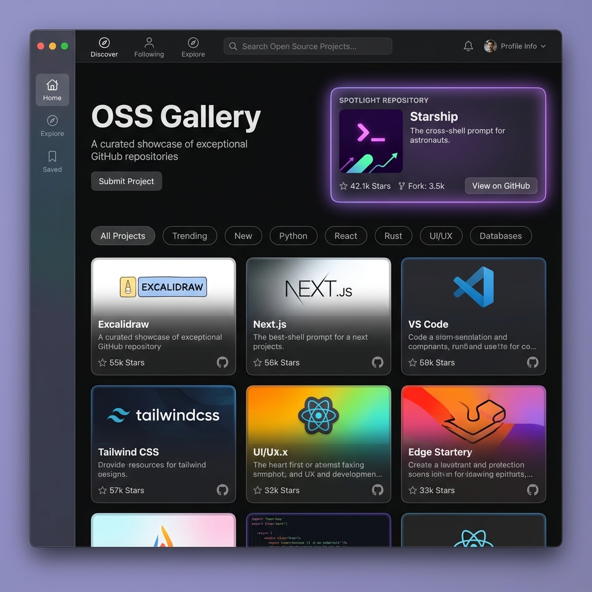

# OSS Gallery 🚀

A curated, visual-driven, native macOS app for discovering exceptional GitHub open-source repositories.
一款专为 Mac 用户打造的高颜值、现代暗黑画廊风格的 GitHub 开源项目探索利器。



---

## ✨ Features (功能特性)

- 🎨 **Modern Dark & Neon Aesthetic**: 深度适配 macOS 极客暗黑风，大量运用 `.ultraThinMaterial` 毛玻璃质感、霓虹发光与 3D 景深悬浮反馈。
- 🖼️ **Visual-First Gallery**: 摒弃枯燥纯文字列表，集成 GitHub OpenGraph 社交卡片作为动态封面。
- 🌟 **Spotlight Recommendations**: 每日精选焦点项目推荐，支持呼吸发光特效与一键探索。
- 🏷️ **Dynamic Pill Categories**: 支持预设分类（🔥 Trending、🤖 AI / LLM、🛠️ Tools、🍎 SwiftUI）与自定义搜索标签。
- 🎲 **Random Explore**: 抽卡式“随机探索”全屏浮层，随时发掘宝藏项目。
- 💾 **Favorites & Bookmarks**: 本地收藏夹持久化管理，支持多维度排序。
- 👥 **Curated Authors**: 关注顶级开源创作者动态。
- 🪟 **Native Window System**: 独立控制台窗口与项目详情窗口，支持全屏缩放与标准 macOS 交互。
- ⚡ **Zero-Cost Architecture**: 纯客户端直连 GitHub API，无需自建服务器；支持匿名降级模式与 Personal Access Token (PAT) 高频模式。

---

## 🛠️ Tech Stack (技术栈)

- **Language**: Swift 5.9+
- **Framework**: SwiftUI (macOS 14.0+)
- **Architecture**: MVVM (Model-View-ViewModel)
- **Data & Network**: `URLSession` + `@AppStorage` (UserDefaults)
- **Package Manager**: Swift Package Manager (SPM)

---

## 🚀 Quick Start (快速开始)

### 运行环境
- macOS 14.0 (Sonoma) 或更高版本
- Xcode 15+ 或 Command Line Tools

### 方式一：一键打包并运行 (推荐)
在项目根目录下直接执行：
```bash
./scripts/build-app.sh release run
```
脚本会自动编译并打包成标准的 `build/OSSGallery.app` 并直接启动。

### 方式二：在 Xcode 中打开
直接打开项目目录下的 `Package.swift`：
```bash
open Package.swift
```
在 Xcode 中选择目标设备为 `My Mac`，按 `Cmd + R` 编译运行。

---

## ⚙️ Configuration (配置指南)

应用开箱即用（默认走 GitHub 匿名接口，限流 60次/小时）。
若需解锁 5000次/小时 的高频访问额度：
1. 点击主界面右上角的 **控制台 (Settings)** 图标。
2. 在 **General** 中填入您的 GitHub Personal Access Token (PAT)。
3. 在 **Categories** 中可自由添加/删除自定义标签规则（如 `topic:rust sort:stars`）。

---

## 📄 License

MIT License
